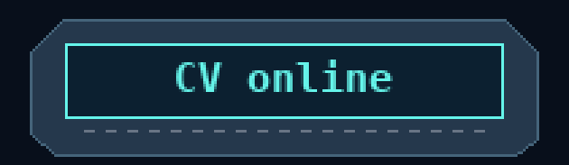

# Lucas Ruiz

Estudio ASIX y hago mi formación dual en Telefónica. Me interesan las redes, la administración de sistemas y la ciberseguridad. Disfruto montando laboratorios con Linux y virtualización para entender cómo funcionan servicios como DNS y DHCP.

## Proyectos

<!-- Cuando MISIÓN RED tenga un enlace público, añade su cartucho destacado justo debajo de este comentario, con portada local, texto alternativo, descripción y enlace. -->

### RealityBox

Tienda de cajas sorpresa hecha con Laravel. Puedes explorar el catálogo, simular aperturas con saldo de demo y guardar las recompensas en tu inventario. Incluye un panel de administración para gestionar los productos.

[Ver RealityBox en GitHub](https://github.com/Lucasruizg/RealityBox)

### Otros cartuchos

#### CV online

Currículum en HTML y CSS, adaptable a móvil y con vista de impresión para exportarlo a PDF.

[Ver el repositorio del CV online](https://github.com/Lucasruizg/CV_LucasRuiz)

#### Travel Dashboard

Panel que consulta el tiempo de una ciudad y convierte euros a su moneda local.

[Ver Travel Dashboard en GitHub](https://github.com/Lucasruizg/Travel_Dashboard)
