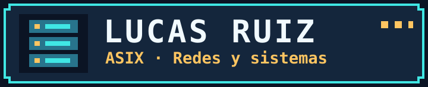
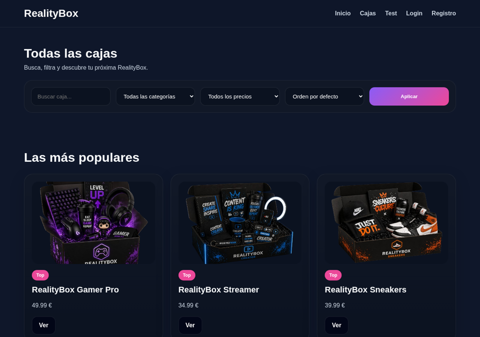
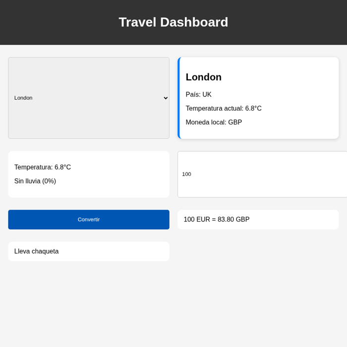

[**▸ Proyectos**](#proyectos) · [**CV**](https://github.com/Lucasruizg/CV_LucasRuiz) · [**Contacto**](mailto:lksruizg@gmail.com)

Estudio ASIX en La Salle Gràcia y hago la formación dual en Telefónica. He trabajado con routers Teldat, VLAN y montajes en rack.

## Proyectos

**[RealityBox](https://github.com/Lucasruizg/RealityBox)** · Aplicación Laravel con catálogo, panel de administración y apertura de cajas con saldo ficticio.

Ver captura del catálogo

**[Travel Dashboard](https://github.com/Lucasruizg/Travel_Dashboard)** · Panel web para consultar el clima y convertir monedas.
