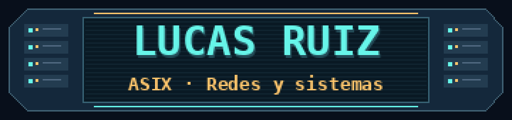
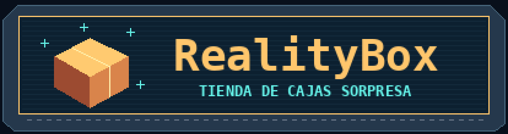
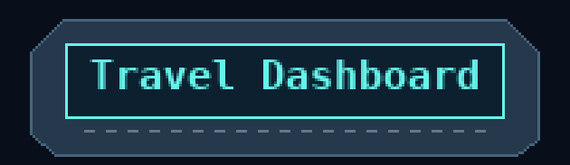

<!-- Cuando MISIÓN RED tenga una demo pública verificada, enlázala como primera acción y coloca su cartucho al inicio de Proyectos. -->
[**▸ RealityBox**](#realitybox) · [**Proyectos**](#proyectos) · [**CV**](https://lucas-ashy.vercel.app/) · [**Contacto**](#contacto)

Estudio ASIX y hago mi formación dual en Telefónica. 
Allí he trabajado con routers Teldat, VLAN y montajes en rack.

## Proyectos

### RealityBox

Tienda de cajas sorpresa en Laravel. Abre cajas con saldo de prueba y guarda los premios en tu inventario.

[**Abrir RealityBox y ver cómo probarlo en local**](https://github.com/Lucasruizg/RealityBox#instalacion)

### Travel Dashboard

Consulta el tiempo en la ciudad que elijas y convierte euros a su moneda local.

[**Abrir Travel Dashboard**](https://travel-dashboard-amber-phi.vercel.app/)

## Tecnologías

Teldat · VLAN · Linux · Bash · Git · VirtualBox · Windows Server · PHP/Laravel · MySQL

## Contacto

[Escríbeme por correo](mailto:lksruizg@gmail.com)
